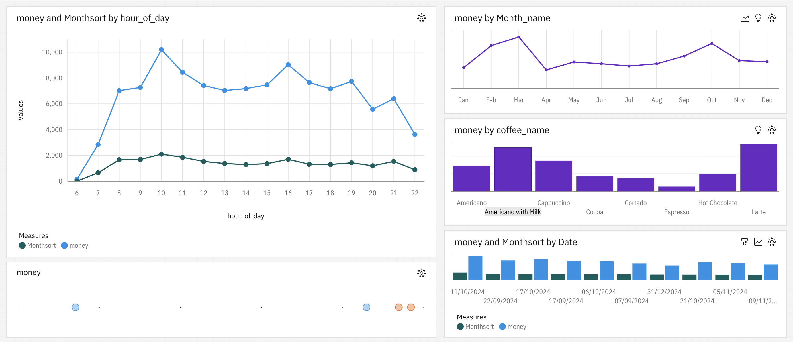

# BrewMetrics: Sales Pattern Analysis for a Coffee Business Using IBM Cognos Analytics

An interactive business intelligence dashboard, built in IBM Cognos Analytics, that analyses coffee shop transaction data by hour of day, day of week, month, and product. It is designed to show when the business is busiest and which products drive revenue.

---

## Table of Contents

1. [Overview](#overview)
2. [Motivation](#motivation)
3. [Problem Statement](#problem-statement)
4. [Dashboard Features](#dashboard-features)
5. [Analysis Dimensions](#analysis-dimensions)
6. [Dashboard Preview](#dashboard-preview)
7. [Key Findings](#key-findings)
8. [Tech Stack](#tech-stack)
9. [Repository Structure](#repository-structure)
10. [Usage](#usage)
11. [Limitations](#limitations)
12. [Future Work](#future-work)

---

## Overview

BrewMetrics turns raw sales transactions from a coffee shop into a set of linked visualisations. A manager can see revenue over time, compare weekdays and hours, and break results down by product (for example Americano, Latte, and Cappuccino) using combined time and product filters.

## Motivation

Food and beverage businesses make daily decisions about staffing, stocking, and promotions, and those decisions depend on knowing when customers arrive and what they buy. Transaction data holds this information, but in raw form it is hard to read.

This project was built to practise turning transactional data into a dashboard that answers operational questions directly, using an enterprise business intelligence tool.

## Problem Statement

A business owner looking at a table of transactions cannot easily answer questions such as:

- Which hours and weekdays are busiest?
- How does revenue change from month to month?
- Which products contribute most, and when are they bought?

The dashboard answers these through interactive charts and filters rather than manual spreadsheet work.

## Dashboard Features

- Interactive charts that respond to filters
- Filters for hour, month, and product, which can be combined to drill down
- Sales distribution by hour of day and day of week
- Monthly revenue trends with seasonal comparison
- Product-level performance comparison
- Export of views for reporting

## Analysis Dimensions

| Dimension | Question addressed |
|---|---|
| Hour of day | When are the peak business hours? |
| Day of week | Which weekdays generate the most sales? |
| Month | How does revenue trend and vary seasonally? |
| Product | Which products perform best, and in which time slots? |

## Dashboard Preview



## Key Findings

<!-- Add 3 to 5 specific findings read from the dashboard, for example: the peak hour and its share of daily sales, the strongest and weakest weekday, the top product by revenue, and any seasonal change. Each finding should name the actual value shown in the dashboard. -->

## Tech Stack

| Component | Tool |
|---|---|
| Dashboarding and visualisation | IBM Cognos Analytics |
| Data | Sample coffee shop transaction dataset |

## Repository Structure

```text
.
├── dashboard_preview.png   # Screenshot of the finished dashboard
└── README.md
```

## Usage

The dashboard is built in IBM Cognos Analytics and is not a standalone application, so opening it requires access to a Cognos Analytics instance.

1. Upload the dataset to IBM Cognos Analytics and create a data module from it.
2. Open the dashboard and use the filters for hour, month, and product to drill into the data.
3. Export the views for reporting as needed.

## Limitations

- The dashboard runs only inside IBM Cognos Analytics, so it cannot be opened without access to the platform; the preview image shows its final state.
- It analyses a sample dataset, so the patterns shown illustrate the method rather than describe a real business.
- The dashboard describes past sales and does not forecast future demand.

## Future Work

- Add demand forecasting by hour and weekday
- Add profit analysis by incorporating product cost data
- Publish an equivalent version in an open-source tool such as Python with Plotly or Streamlit, so it can be run without a proprietary platform
- Include the dataset and a data dictionary in the repository
